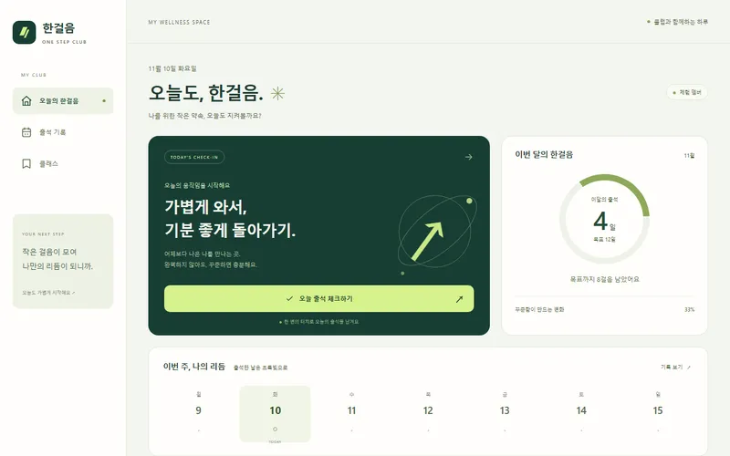

# 한걸음 클럽 · 출석 체크

가상 동네 헬스장의 출석 체크와 주간·월간 기록을 보여 주는 모바일 앱 샘플입니다.
Ionic React와 Capacitor 설정으로 구성하고 설치·오프라인 이용이 가능한 PWA 웹 빌드를 포함합니다.
일부 화면을 Expo의 React Native 컴포넌트로도 구현했습니다. 개인정보 입력과 실제 예약은 없습니다.

## 보는 주소

Pages 공개 예정 주소: https://junetapa-juncheol.github.io/sample-mobile-pwa/

React Native 웹 공개 예정 주소: https://junetapa-juncheol.github.io/sample-mobile-pwa/rn/

GitHub에 올린 뒤 Settings → Pages → Deploy from a branch → main /docs를 선택합니다.
소스와 빌드 결과를 함께 올리고 `docs/.nojekyll`도 포함합니다.



## 쓴 기술

| 기술 | 쓴 곳 |
| --- | --- |
| Ionic React | `src/main.jsx`의 IonApp·IonPage·IonContent·IonButton·IonSegment |
| Capacitor | `capacitor.config.ts`, `@capacitor/core`와 `@capacitor/cli` |
| React | `src/main.jsx` 화면과 출석·메뉴 상태 |
| PWA | `public/manifest.webmanifest`, `public/icons/`, `src/service-worker.js` |
| 서비스 워커 | `scripts/build-sw.mjs`의 빌드 해시·앱 파일 목록, `docs/sw.js` |
| 로컬 저장 | `src/attendance.js`의 가상 출석 날짜 저장·중복 체크·손상 복구 |
| Expo · React Native | `rn/App.jsx`의 SafeAreaView·View·Text·Pressable·StyleSheet |
| Expo 웹 빌드 | `rn/app.json`의 하위 경로 설정, `docs/rn/` |
| Vite · Vitest · ESLint | `vite.config.mjs`, `tests/attendance.test.js`, `eslint.config.mjs` |
| GitHub Actions | `.github/workflows/ci.yml`의 린트·시험·PWA·Expo 빌드 |

## 실행 방법

Node.js 22 이상을 사용합니다.

```sh
npm ci
npm run dev
```

브라우저에서 Vite가 표시하는 주소의 `/sample-mobile-pwa/`를 엽니다.
웹 빌드와 미리보기:

```sh
npm run lint
npm test
npm run build
npm run preview
```

빌드 결과는 `docs/`에 포함했습니다. Vite는 `/sample-mobile-pwa/`를 기준으로 자산 주소를 만듭니다.
서비스 워커는 개발 서버에서는 등록하지 않고 빌드 결과에서만 등록합니다.
최초 온라인 방문 후 파일 캐시가 끝나면 네트워크를 끊고 새로고침해도 기본 화면과 출석 기능을 사용할 수 있습니다.
서비스 워커는 HTTPS 또는 localhost가 필요합니다. 지원 브라우저의 설치 메뉴에서 홈 화면에 추가할 수 있습니다.
설치 가능 여부와 메뉴 명칭은 브라우저에 따라 다릅니다.

```sh
cd rn
npm ci
npm run build
```

위 명령은 `expo export --platform web --output-dir ../docs/rn`을 실행합니다.
루트에서도 `npm run build:rn`으로 실행할 수 있습니다.
Expo의 `experiments.baseUrl`은 `/sample-mobile-pwa/rn`입니다.
Expo 체험은 화면 내 상태만 유지하며 PWA와 저장소를 공유하지 않습니다. RN 화면의 오프라인 캐시는 제공하지 않습니다.

Capacitor는 앱 ID·이름·웹 디렉터리까지 설정했습니다. Android·iOS 네이티브 프로젝트와 실행 파일은 포함하지 않았습니다.
웹 `docs/` 안의 RN 빌드도 Capacitor 패키징 대상에 들어가므로 네이티브 제작 시 필요한 화면만 선택해야 합니다.

## 체험 기능

- 오늘 출석: 같은 날짜의 출석 중복 방지. 브라우저 저장 공간 오류 시 화면에서만 유지하고 안내함.
- 주간·월간 기록: 로컬 날짜 기준, 손상되거나 형식이 잘못된 기록은 가상 표본으로 복구.
- 체험 예약: 화면에서 선택 상태만 바꾸며 실제 예약·개인정보 전송 없음.
- 표본 초기화: 출석 기록 화면에서 초기화. 가상 날짜 기록 외 개인정보는 저장하지 않음.
- 키보드 초점·본문 바로가기·메뉴 이름·390px/1280px 반응형 화면 제공.

초기 출석 기록과 체험 멤버십은 전부 가상 표본입니다. 실제 건강·회원 정보를 수집하지 않습니다.
Flutter SDK가 없는 환경이며, 작업 폴더는 Windows SDK의 권장 설치 조건인 특수문자 없는 경로를 충족하지 않아 Flutter 소스·빌드는 포함하지 않았습니다.
Swift는 macOS가 필요한 이번 범위에서 제외했습니다. 실기기·앱스토어 배포 검증은 수행하지 않았습니다.

## 시험

`npm test`는 현지 날짜, 일별 중복, 월별 집계, 연말 주간, 잘못된 저장값, 저장 공간 제한을 검사합니다.
로컬 Chromium에서 390px·1280px 화면, 출석·재방문·기록·체험 예약·오프라인 새로고침과 RN 화면을 확인합니다.
CI는 위 린트·시험·두 웹 빌드를 실행합니다. 게시 전이므로 원격 CI 결과는 아직 없습니다.

## 라이선스

MIT · 저작권자 junetapa. `LICENSE` 참조. 웹 빌드에 포함된 구성 요소의 고지는 `THIRD_PARTY_NOTICES.md`에 있습니다.
